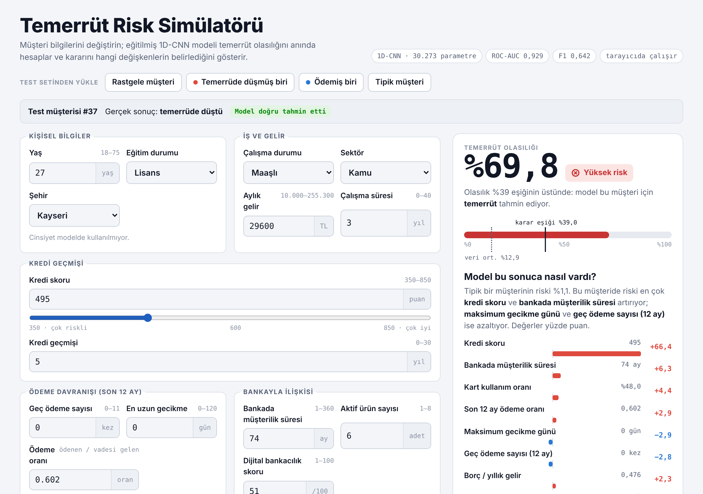
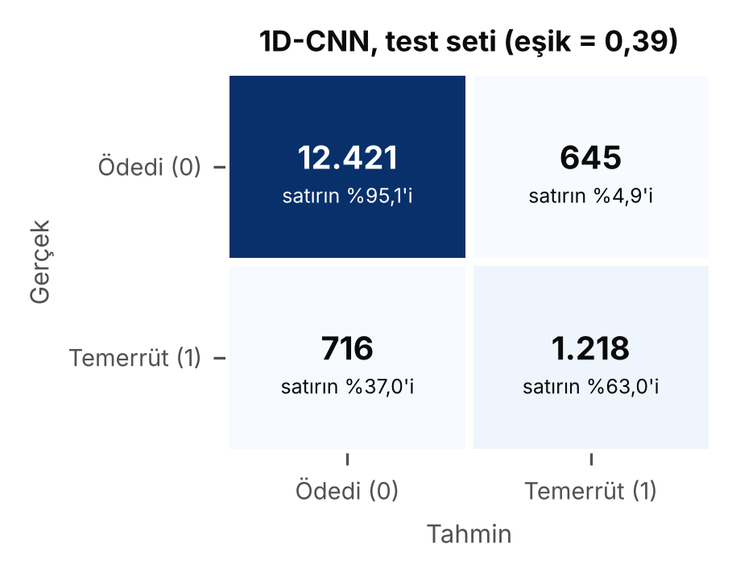
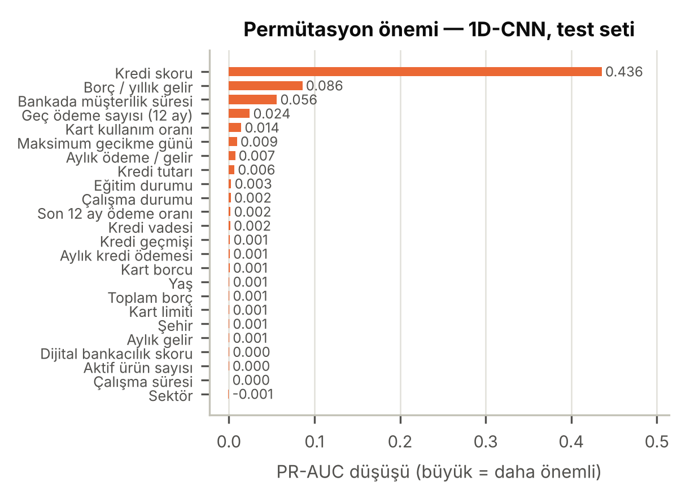
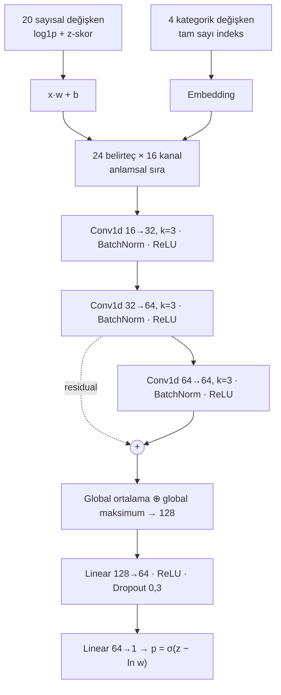

# Kredi Temerrüt Tahmini: Tablo Verisi için 1D-CNN

Bir banka müşterisinin kredi temerrüdüne düşme olasılığını tahmin eden, **PyTorch** ile eğitilmiş bir derin öğrenme modeli ve bu modeli tarayıcıda çalıştıran etkileşimli bir **deneme uygulaması**.

Model, tablo verisini 24 "belirteçten" (token) oluşan bir diziye dönüştürür ve tek boyutlu evrişimle (Conv1d) işler. Eğitimde hiç görülmemiş test setinde **ROC-AUC 0,929**, **PR-AUC 0,703** ve **F1 0,642** değerlerine ulaşır.

**[Canlı demo](https://KULLANICI_ADI.github.io/kredi-temerrut-cnn/)** · **[Rapor (PDF)](report/rapor.pdf)** · **[Notebook](temerrut_cnn.ipynb)**



> Bu bir ders projesidir ve gerçek kredi kararlarında kullanılmamalıdır. Veri seti büyük olasılıkla sentetiktir (bkz. [Veri seti](#veri-seti)).

---

## İçindekiler
- [Sonuçlar](#sonuçlar)
- [Deneme uygulaması](#deneme-uygulaması)
- [Model](#model)
- [Projeyi çalıştırma](#projeyi-çalıştırma)
- [Depo yapısı](#depo-yapısı)
- [Veri seti](#veri-seti)
- [Bulgular ve sınırlamalar](#bulgular-ve-sınırlamalar)

---

## Sonuçlar

Test seti 15.000 müşteriden oluşur ve eğitim, model seçimi veya eşik seçimi sırasında hiç kullanılmamıştır. Her modelin karar eşiği, doğrulama setinde F1'i en yüksek yapan değer olarak seçilmiştir.

| Model | Eşik | Accuracy | Precision | Recall | F1 | ROC-AUC | PR-AUC |
|---|---|---|---|---|---|---|---|
| **1D-CNN (anlamsal sıra)** | 0,39 | 0,9093 | 0,6538 | 0,6298 | 0,6416 | 0,9287 | 0,7027 |
| 1D-CNN (rastgele sıra) | 0,35 | 0,9095 | 0,6550 | 0,6293 | 0,6419 | 0,9271 | 0,7014 |
| MLP (aynı tokenizer) | 0,36 | 0,9023 | 0,6083 | 0,6810 | 0,6426 | 0,9278 | 0,7006 |
| Lojistik Regresyon | 0,34 | 0,9068 | 0,6309 | 0,6680 | 0,6489 | 0,9295 | 0,7040 |
| Gradient Boosting | 0,38 | 0,9082 | 0,6453 | 0,6396 | 0,6424 | 0,9273 | 0,6971 |
| Naif taban (herkese "ödüyor") | – | 0,8711 | 0 | 0 | 0 | 0,5000 | 0,1289 |

- **Accuracy tek başına yanıltıcıdır.** Müşterilerin %87,1'i kredisini ödediği için herkese "ödüyor" diyen bir model bile %87 doğruluk alır. Asıl ölçütler precision, recall, F1 ve PR-AUC'dir.
- CNN gerçek temerrütlerin **%63'ünü** yakalar. Alarm verdiği her 3 müşteriden yaklaşık 2'si gerçekten temerrüde düşer.
- Beş model de aynı tavana takılır. Bu veride evrişim klasik modellere üstünlük sağlamaz (bkz. [Bulgular](#bulgular-ve-sınırlamalar)).

<p align="center">
  
  
</p>

---

## Deneme uygulaması

Uygulama tek bir HTML dosyasıdır (`docs/index.html`). Eğitilmiş modelin ağırlıklarını içinde taşır ve tahmini tamamen tarayıcıda, JavaScript ile hesaplar. Sunucu, Python veya internet bağlantısı gerektirmez; yalnızca yazı tipleri internetten yüklenir. JavaScript sürümünün çıktısı, 400 test müşterisinde PyTorch modelinden en fazla 0,000003 farklıdır.

### Uygulamayı açma

| Yol | Nasıl |
|---|---|
| **Canlı demo** | [KULLANICI_ADI.github.io/kredi-temerrut-cnn]([https://KULLANICI_ADI.github.io/kredi-temerrut-cnn/](https://github.com/BarbarosUmut/CNN-s-forecast-for-the-recession/tree/main/docs)) adresini açın. |
| **Bilgisayarınızda** | Depoyu indirin ve `docs/index.html` dosyasına çift tıklayın. |
| **Kendi modelinizle** | Notebook'u çalıştırın, ardından `python app/build_app.py` komutuyla uygulamayı yeni ağırlıklarla yeniden derleyin. |

### Adım adım kullanım

**1. Bir müşteri yükleyin.** Sayfanın üstündeki düğmeler formu doldurur:

| Düğme | Ne yapar |
|---|---|
| Rastgele müşteri | Test setinden rastgele bir müşteri yükler. |
| Temerrüde düşmüş biri | Gerçekte temerrüde düşmüş bir test müşterisi yükler. |
| Ödemiş biri | Gerçekte kredisini ödemiş bir test müşterisi yükler. |
| Tipik müşteri | Her değişkenin eğitim setindeki medyanını (kategorilerde en sık değeri) yükler. Kendi senaryonuz için iyi bir başlangıç noktasıdır. |

Uygulama 400 gerçek test müşterisini içerir. Bu müşteriler model eğitilirken hiç görülmemiştir. Bir test müşterisi yüklediğinizde, altındaki bilgi şeridi müşterinin **gerçek sonucunu** ve **modelin doğru mu yanlış mı tahmin ettiğini** gösterir. Böylece modelin hatalarını da kendi gözünüzle görebilirsiniz. Uygulama, modelin doğru yakaladığı gerçek bir temerrüt vakasıyla (Test müşterisi #37) açılır.

**2. Bilgileri değiştirin.** Form sekiz gruptan oluşur:

| Grup | Alanlar |
|---|---|
| Kişisel bilgiler | Yaş, eğitim durumu, şehir |
| İş ve gelir | Çalışma durumu, sektör, aylık gelir (TL), çalışma süresi (yıl) |
| Kredi geçmişi | Kredi skoru (350–850, kutu veya kaydırıcı), kredi geçmişi (yıl) |
| Ödeme davranışı | Son 12 aydaki geç ödeme sayısı, en uzun gecikme (gün), ödeme oranı (ödenen ÷ vadesi gelen) |
| Bankayla ilişkisi | Müşterilik süresi (ay), aktif ürün sayısı, dijital bankacılık skoru (1–100) |
| Kredi kartı | Kart limiti, kart kullanım oranı (%) |
| Kredi | Kredi tutarı, kredi vadesi |
| Borç yükü | Kart ve kredi dışındaki diğer borçlar |

Her değişiklikte sonuç anında yeniden hesaplanır; "hesapla" düğmesi yoktur.

- **Türetilmiş alanlar kendiliğinden güncellenir.** Kart borcu (limit × kullanım), aylık kredi ödemesi (tutar ÷ vade × faiz), toplam borç, borç/yıllık gelir ve aylık ödeme/gelir oranları elle girilmez. Bu alanlar veri setindeki formüllerle hesaplanır ve grup kutusunun altında gösterilir. Örneğin geliri artırdığınızda borç/gelir oranı da düşer.
- **Değerler eğitim aralığıyla sınırlıdır.** Her alanın yanında modelin eğitimde gördüğü aralık yazar (ör. yaş 18–75). Aralık dışı bir değer girerseniz en yakın sınıra çekilir, çünkü model görmediği değerlerde güvenilir değildir.
- Kredi tutarını 0 yaparsanız vade "Kredi yok" olur; vadeyi "Kredi yok" seçerseniz tutar 0 olur.
- Cinsiyet alanı yoktur. Veride iki cinsiyetin temerrüt oranı aynıdır (%12,9) ve kredi kararında cinsiyet kullanmak etik değildir.

**3. Sonucu okuyun.** Sağdaki panel (telefonda formun üstünde) modelin kararını gösterir:

| Öğe | Anlamı |
|---|---|
| **Temerrüt olasılığı** | Modelin kalibre edilmiş tahmini. "%30" demek, bu profildeki müşterilerin yaklaşık %30'unun temerrüde düşmesi beklenir demektir. |
| **Risk etiketi** | **Düşük:** veri ortalamasının (%12,9) altı. **Orta:** ortalama ile karar eşiği (%39) arası. **Yüksek:** eşiğin üstü. |
| **Karar cümlesi** | Olasılık %39'un üstündeyse model "temerrüt", altındaysa "ödeyecek" der. |
| **Gösterge çubuğu** | Olasılığın konumu. Düz siyah çizgi karar eşiğini (%39), noktalı çizgi veri ortalamasını (%12,9) gösterir. |

Telefonda sayfanın altında küçük bir olasılık rozeti durur. Form doldururken sonucu görmeye devam edebilir, rozete dokunarak panele dönebilirsiniz.

**4. Açıklamayı okuyun: "Model bu sonuca nasıl vardı?"** Bu bölüm, kararı en çok etkileyen 8 değişkeni gösterir:

- Her değişken için şu soru sorulur: *Bu değişken tipik müşterinin değerinde olsaydı, risk ne olurdu?* Çubuk, o durumdaki risk ile şimdiki risk arasındaki farkı **yüzde puan** olarak gösterir. Bu yönteme **occlusion** (örtme) denir.
- **Kırmızı çubuk (sağa, +)** riski artıran değişkenleri, **mavi çubuk (sola, −)** riski azaltan değişkenleri gösterir.
- Çubuğun üzerine gelince tipik değeri ve o değerle hesaplanacak riski görebilirsiniz.
- Çubuklar ayrı ayrı hesaplanır, bu yüzden toplamları toplam riske birebir eşit olmaz. Değişkenler birbirini etkilediği için bu beklenen bir durumdur.

**5. Sayfanın altı.** Burada modelin test seti metrikleri, genel olarak en çok baktığı değişkenler (permütasyon önemi) ve mimarinin özeti yer alır.

### Denemeye değer senaryolar

| Senaryo | Ne görürsünüz |
|---|---|
| Açılıştaki müşteri (#37): geç ödemesi yok ama kredi skoru 495, risk %69,8. Skoru adım adım artırın. | Skor 520'de risk %54, **540'ta %38,9 ile eşiğin altına** iner, 600'de %8,5 olur. Kredi skoru modelin en güçlü değişkenidir. |
| Aynı müşteride şehri İstanbul, Van, Muğla veya Mardin yapın. | Risk yalnızca %67–70 arasında oynar. Şehir zayıf bir sinyaldir. |
| "Tipik müşteri"yi yükleyin (risk %1,1), sonra kredi skorunu 560'a indirin. | Risk %11,3'e çıkar. Ardından geç ödeme sayısını 4 yapın: %21,5. |
| Tipik müşteride yalnızca geç ödemeyi 5'e, en uzun gecikmeyi 60 güne çıkarın. | Risk %8,9'da kalır. Skor iyi olduğu sürece model ödeme davranışına daha az tepki verir. |
| "Temerrüde düşmüş biri" düğmesine birkaç kez basın. | Bazı müşterilerde şerit "Model yanıldı" der. Bu müşterilerin çoğu orta skorlu ve "temiz görünen" müşterilerdir. |

### Sınırlamalar
- Model sentetik görünen bir veri setinde eğitildi; gerçek bir bankanın müşterilerine genellenemez.
- Açıklamalar tek değişkenli bir yaklaşımdır. Birbirine bağlı değişkenlerin (ör. yaş ve çalışma süresi) ortak etkisini ayrıştırmaz.
- Eğitim aralığı dışındaki uç değerler kırpılır.

---

## Model

Tablo verisinde sütun sırası keyfidir, bu yüzden CNN'i ham satıra uygulamak anlamsızdır. Model veriyi önce evrişimin anlamlı olacağı bir yapıya çevirir:

1. **Feature Tokenizer:** Her sayısal değişken kendi öğrenilebilir vektörleriyle (`x·w + b`), her kategorik değişken bir embedding tablosuyla 16 boyutlu bir belirtece dönüşür. Her müşteri 24 × 16'lık bir dizi olur.
2. **Anlamsal sıra:** Belirteçler ilişkili değişkenler yan yana gelecek şekilde dizilir: demografi → iş/gelir → banka ilişkisi → kredi geçmişi → kredi kartı → kredi → borç yükü → ödeme davranışı. Böylece genişliği 3 olan evrişim penceresi, örneğin *kart limiti, kullanım oranı ve kart borcu* üçlüsünü birlikte görür.
3. **Evrişim ve sınıflandırma:** Aşağıdaki şemada gösterilmiştir.



| Bileşen | Seçim |
|---|---|
| Parametre sayısı | 30.273 |
| Kayıp fonksiyonu | `BCEWithLogitsLoss(pos_weight = 6,75)`: azınlık sınıfının hataları ~6,75 kat ağırlıklı |
| Olasılık düzeltmesi | `p = σ(z − ln w)`: ağırlıklandırmanın yarattığı şişmeyi giderir (ortalama tahmin %28,4 → %12,9) |
| Optimizer | AdamW, lr = 1e-3, weight decay = 1e-4, ReduceLROnPlateau |
| Batch / epoch | 512 / en fazla 40, doğrulama PR-AUC'sine göre erken durdurma (sabır 6) |
| Veri bölme | %70 eğitim / %15 doğrulama / %15 test, stratified, tohum 42 |
| Karşılaştırma | Rastgele sıralı CNN, aynı tokenizer'lı MLP, lojistik regresyon, gradient boosting |

---

## Projeyi çalıştırma

```bash
# 1) Depoyu klonlayın
git clone https://github.com/KULLANICI_ADI/kredi-temerrut-cnn.git
cd kredi-temerrut-cnn

# 2) Paketleri kurun (Python 3.10+)
pip install -r requirements.txt

# 3) Veri setini Kaggle'dan indirip depo kök klasörüne koyun:
#    turkiye_2026_temerrut_tahmin_verisi_100k.csv

# 4) Notebook'u baştan sona çalıştırın (CPU'da ~4 dakika)
jupyter notebook temerrut_cnn.ipynb

# 5) (İsteğe bağlı) Uygulamayı yeni ağırlıklarla yeniden derleyin
python app/build_app.py
```

Notebook çalıştığında grafikleri `figures/` klasörüne (PNG ve PDF), modeli ise `model_export/` klasörüne yazar. Tüm rastgelelik kaynakları sabit tohumla (42) başlatıldığı için sonuçlar tekrarlanabilir.

**GitHub Pages ile canlı demo yayınlama:** Depo ayarlarında *Settings → Pages* bölümünü açın. *Source* olarak "Deploy from a branch" seçin, dal olarak `main`, klasör olarak `/docs` seçip kaydedin. Bir iki dakika sonra uygulama `https://KULLANICI_ADI.github.io/kredi-temerrut-cnn/` adresinde yayında olur.

---

## Depo yapısı

```
kredi-temerrut-cnn/
├── temerrut_cnn.ipynb        # Ana notebook: EDA, ön işleme, model, eğitim, değerlendirme, hata analizi
├── requirements.txt
├── figures/                  # Notebook'un ürettiği 14 grafik (PNG + PDF)
├── model_export/
│   ├── tabular_cnn.pt        # PyTorch ağırlıkları ve yapılandırma
│   ├── preprocess.json       # Ön işleme parametreleri (ortalama, std, kategori sözlükleri)
│   └── app_model.json        # Uygulamanın kullandığı ağırlıklar ve örnek müşteriler
├── app/
│   ├── template.html         # Uygulamanın arayüzü
│   ├── model.js              # Modelin JavaScript ile çıkarımı (BatchNorm katlanmış)
│   └── build_app.py          # template + model.js + app_model.json → docs/index.html
├── docs/
│   └── index.html            # Derlenmiş uygulama (GitHub Pages bu klasörü yayınlar)
├── report/
│   ├── main.tex              # IEEE formatında rapor (Overleaf ile derlenebilir)
│   ├── figures/
│   └── rapor.pdf
└── assets/
    └── uygulama.png          # README ekran görüntüsü
```

---

## Veri seti

**Türkiye 2026 Kredi Temerrüt Dataset** — Kaggle: <https://www.kaggle.com/datasets/kivancbaysal/trkiye-2026-kredi-temerrt-dataset>

- 100.000 müşteri, 28 sütun, eksik değer yok.
- Hedef değişken `Temerrut`: %87,1 ödedi, %12,9 temerrüde düştü (≈ 6,75 : 1 dengesizlik).
- Modelde 24 değişken kullanıldı. Müşteri no ve adı bilgi taşımadığı için, cinsiyet ise tahmin gücü olmadığı ve etik açıdan sorunlu olduğu için çıkarıldı.
- Veri büyük olasılıkla **sentetiktir**. Kaggle sayfası "synthetic" etiketini taşır, türetilmiş sütunlar formüllere birebir uyar ve iki cinsiyetin temerrüt oranı aynıdır.

Kaggle sayfasında bir lisans belirtilmediği için veri dosyası bu depoya eklenmemiştir. Dosyayı Kaggle'dan indirip depo kök klasörüne koyun.

---

## Bulgular ve sınırlamalar

- **Evrişim bu veride ek kazanç sağlamadı.** Belirteç sırasını rastgele karıştırmak sonucu değiştirmedi, MLP aynı seviyede kaldı ve lojistik regresyon en iyi F1'i aldı. Log ve ölçek dönüşümünden sonra değişkenlerle risk arasındaki ilişki büyük ölçüde doğrusal; evrişimin yakalayacağı karmaşık etkileşimler veride yok.
- **Model kredi skoruna güçlü biçimde bağımlı.** Kredi skoru karıştırıldığında PR-AUC 0,436 düşüyor; ikinci sıradaki borç/gelir oranında bu düşüş yalnızca 0,086.
- **Kaçırılan temerrütler "temiz görünen" müşteriler.** Kaçırılan 716 vakanın %78'i 550–650 skor aralığında. Bu müşterilerin geç ödemesi ve borç yükü düşük; temerrüt nedenleri büyük olasılıkla veride olmayan olaylar (iş kaybı, gelir şoku gibi).
- **Yanlış alarmlar düşük skorlu ama ödeyen müşterilerde yoğun.** Skoru 550'nin altında olup ödeyen müşterilerin %42'si alarm alıyor.

**Geliştirme önerileri:** maliyet duyarlı eşik seçimi; ardışık ayların gerçekten ilişkili olduğu aylık ödeme geçmişi gibi zaman serisi verisiyle 1D-CNN; FT-Transformer / TabNet; çok tohumlu tekrar ve çapraz doğrulama; SHAP ile bireysel açıklama. Ayrıntılar [rapordadır](report/rapor.pdf).

---

## Yazar

**Umut Barbaros BABAHAN** — Yapay Zeka Mühendisliği, OSTİM Teknik Üniversitesi, Ankara

*Uçtan Uca Yapay Zeka Projesi: Veriden Tahmine* kapsamında hazırlanmıştır.
